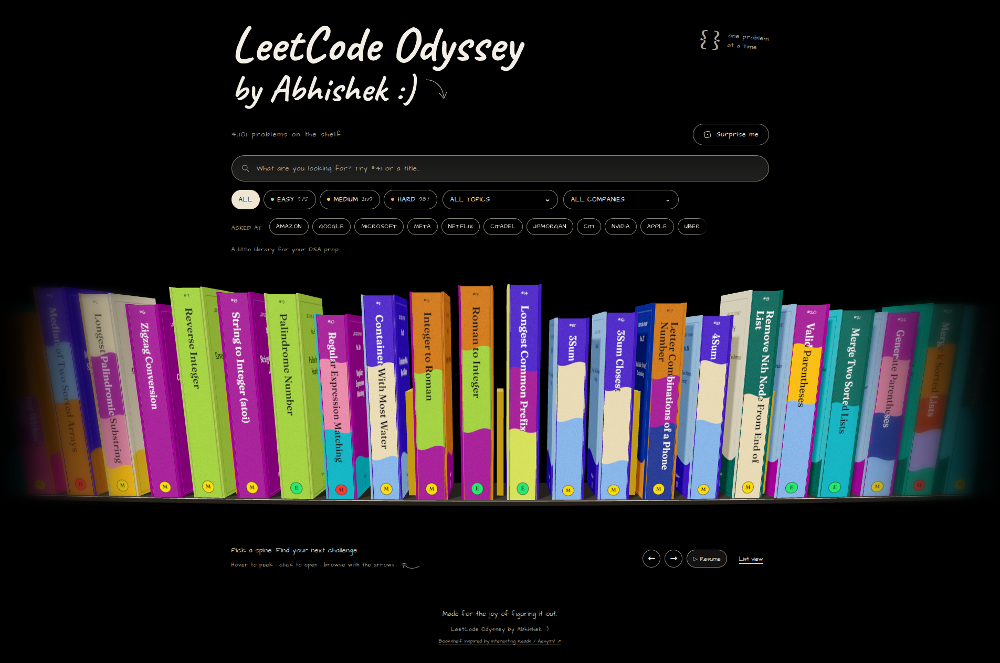
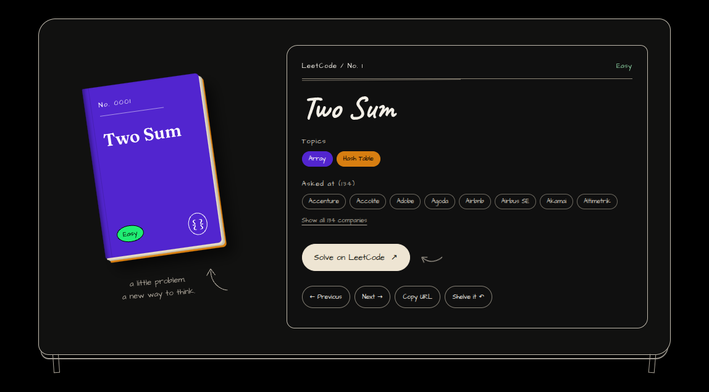

# LeetCode Odyssey by Abhishek :)

A library of **4,101 LeetCode problems**, reimagined as a moving 3D bookshelf. Browse by difficulty, topic, or company, pick a spine, and open your next problem on LeetCode.

<p align="center">
  <a href="https://leetcode-odyssey.vercel.app/"></a>
</p>

## Preview

[](https://leetcode-odyssey.vercel.app/)

Selecting a book opens its difficulty, topics, company associations, and LeetCode link.



- **[Open the live Vercel preview](https://leetcode-odyssey.vercel.app/)**
- **[Browse the problem CSV](./leetcode_problems.csv)**
- **[Company-wise CSVs](./companies/)**

## Credits

- **Company-wise data:** [liquidslr/leetcode-company-wise-problems](https://github.com/liquidslr/leetcode-company-wise-problems) and [snehasishroy/leetcode-companywise-interview-questions](https://github.com/snehasishroy/leetcode-companywise-interview-questions). Thank you to both maintainers and their contributors for keeping these community lists available.
- **Data cleaning and formatting:** Myself with help of AI (started from a very rough script).
- **Inspiration:** Achina Maaya's [Interesting Reads](https://interesting-reads.vercel.app/), shared through [AevyTV](https://www.youtube.com/@aevytv). Her idea of turning a personal essay collection into colorful books on a moving shelf inspired this problem library.
- **Entire 3D UI:** built by **GPT6.1 Sol**, with the requirements, direction, and iterative prompts from Abhishek.

## What you can do

- Search by problem number or title, then combine difficulty, topic, and company filters.
- Use shortcuts for popular companies or search the full company list.
- Read the topic colors on each spine; green, yellow, and red **E/M/H** stickers show difficulty.
- Hover to lift a book, click for details, and use Previous, Next, Copy URL, or Shelve it.
- Let Surprise me choose a problem from the full catalog.
- Pause the shelf, browse with the arrow controls, or switch to the keyboard-accessible list view. Reduced-motion preferences are respected.

## How the 3D UI is built

The app uses **React 19, TypeScript, and Vite**, with **Three.js through React Three Fiber** for rendering and **Rapier** for falling-book physics.

Each book is assembled from separate front and back cover boards, a bound spine, and a recessed page block. Canvas-generated artwork supplies the topic-colored wave sections, printed covers, paper grain, and page lines. Cloth bump maps, directional lighting, highlights, and cast shadows add depth. Topic colors and section proportions stay stable between visits; spine text switches between black and white for readability.

Books move along a shallow curve and face straight ahead at the center. Only a window of books is rendered, with extra books outside the edges and a dark blur to conceal recycling. Filtering lets unrelated books fall while the remaining books ease into place. Clicking holds the shelf during selection; Shelve it returns the book and finishes the detail exit before autoplay resumes.

The handwritten headings and controls use **Caveat** and **Architects Daughter**; book titles use **Fraunces**. Fonts are bundled locally.

## How the data is pulled, cleaned, and formatted

1. **Fetch the catalog.** [leetcode.py](./leetcode.py) scans LeetCode's paginated problem ID/slug index and fetches full metadata only for IDs missing from [leetcode_problems.csv](./leetcode_problems.csv). It appends new rows while preserving existing rows, extra columns, and company associations. Failed requests do not publish a partial update.
2. **Merge company lists.** [sync.py](./sync.py) clones or updates both credited GitHub repositories. It reads their company/time-range CSVs, normalizes names and difficulty labels, applies explicit company aliases, matches records to the catalog, and removes duplicate problem entries within each company.
3. **Write consistent CSVs.** The sync creates one CSV per company in [companies/](./companies/) and updates the master CSV's `company` column with semicolon-separated company names. Applicable source time ranges are combined in each company CSV's `range` column.
4. **Skip unchanged syncs.** [sync.json](./sync.json) records the upstream commit hashes, catalog hash, and company-file count. If those inputs and expected outputs are unchanged, the company rebuild is skipped.
5. **Build the UI dataset.** [scripts/build-data.mjs](./scripts/build-data.mjs) validates and converts the master CSV to `public/problems.json` automatically before development or production builds. The browser loads that static dataset; it does not scrape LeetCode at runtime.

The master CSV uses this schema:

| Column | Content |
| --- | --- |
| `Problem No` | LeetCode problem number |
| `Link` | Direct problem description URL |
| `Title` | Problem title |
| `Difficulty` | Easy, Medium, or Hard |
| `Topics` | Comma-separated topic names |
| `company` | Semicolon-separated company names |

Company associations reflect the available community snapshots. An empty company or topic field means that metadata is absent from the dataset.

## Run locally

Use **Node.js 24 or newer**.

```bash
npm ci
npm run dev
```

Open the local URL printed by Vite.

To refresh the data, install **Python 3** and **Git**, then run:

```bash
python3 leetcode.py
python3 sync.py
```

Both Python scripts use the standard library. Run the exporter first, then the company sync so new problems can receive company associations. Restart development or rebuild after refreshing the CSV. For sync options and matching rules, see [SYNC.md](./SYNC.md).

## Check, build, and deploy

```bash
npm test
python3 -m unittest -v test_leetcode.py test_sync.py
npm run build
npm run preview
```

The app is live at **[leetcode-odyssey.vercel.app](https://leetcode-odyssey.vercel.app/)**.

To deploy your own copy on Vercel, import the repository and use:

| Setting | Value |
| --- | --- |
| Framework preset | Vite |
| Install command | `npm ci` |
| Build command | `npm run build` |
| Output directory | `dist` |

A data refresh becomes visible in a deployed build after rebuilding and redeploying the updated CSV.

## Prompts

The 15 project prompts from this session are reproduced below in chronological order, including this README request. Original wording is preserved; local file mentions are shortened to repository-relative names, and automatic browser/editor context is omitted. Earlier prompts describe earlier design iterations. The reference screenshot mentioned in prompt 10 was supplied as an attachment.

<details>
<summary>Read all 15 prompts</summary>

### 01. Export the question catalog

> have a look at @leetcode.py
> i want all the 4100 questions in a csv or a tabular format
> problem no | title | difficulty | topics (optional)
>
> @leetcode.py

### 02. Add company-wise data and commit-aware sync

> https://github.com/liquidslr/leetcode-company-wise-problems
> https://github.com/snehasishroy/leetcode-companywise-interview-questions
>
> these are the top repos that maintain the list of leetcode questions.
> clone these repos and get the hang of the repo structure.
>
> after analysing both the repos
> create a directory name "companies" in root folder and create a csv for each company.
> also i want add a column named company in the @attachment:leetcode_problems.csv that will have the company name if that question is asked.
>
> create a script that will clone the repo and do the data cleaning
> and create a config file that will save the latest commit of the repos so that if i tried to run the script and there is no new commits on the repos it should not run the workflow, it will be of no use.
> okay did you get what i am trying to build.
>
> ask questions to clear any ambiguity before executing.
>
> @leetcode_problems.csv

### 03. Add LeetCode links

> add a link column after the problem number
> the link is just the problem title in smallcase and the spaces replaced by "-"
> ex: 41 https://leetcode.com/problems/first-missing-positive/description/
> 40 https://leetcode.com/problems/combination-sum-ii/description/
> update the @sync.py and @leetcode.py script as well to accomidate this change
>
>
> @leetcode.py
>
> @sync.py
>
> @leetcode_problems.csv

### 04. Study Interesting Reads and plan the UI

> now i need you to go through this site https://interesting-reads.vercel.app/ and figure out how its made and study the design, typography, layout, colors, animation.
> copy the UI structure as it is from https://interesting-reads.vercel.app/
> the intreasting reads was built by aachina maya from avey tv youtube channel
> here is the transcript of the youtube short that she posted.
> "I turned 283 of my favorite essays into this personal library and you all loved it. So, I thought [music] I would show you exactly how it all came together and share the prompts I used at the end. Okay, so first, I opened Claude and I told it I want to build a beautiful corner for all my favorite essays so I can keep coming back to them, okay? While Whisper Flow did all the typing for me. Now, to get started, I put all the essay links into a PDF. Now, you could use your bookmarked articles, favorite newsletters, whatever you keep meaning to come back to. I gave them to Claude to organize my topic and verify all the links, okay? Then, I asked it to turn >> [music] >> every essay into a colorful book with different heights, different thicknesses against a black background so the colors would pop, kind of like a >> [music] >> candy store. Now, once I finalize the aesthetic, I was like, "Okay, uh now put all of these books on the shelf." Actually, wait, why should it just sit there? Make the shelf rotate slowly. Or, uh eight cheese, what if when I choose the topic, all the unrelated books just fall off the shelf? That'd be cool, no? And as I kept running my mind, just like that, while I was talking, all the fillers were gone. Whisper Flow kept up as I switched between Hindi, English, or changed my mind mid-sentence. You know, if I were typing, I might have stopped at put them on a wooden shelf, but once I start explaining, I was like, "Wait, maybe I could add this or that or try this or that." And that's how I thought of adding a surprise me button for days [music] when I can't decide what to read as well. Yeah, it was that easy. I was just talking like this. After some more tweaks, I hosted it online >> [music] >> so you all could browse my little digital library as well. And if you also want to build yours, I'll share all the prompts I used along with a link to Whisper Flow."
>
> i want to build the same type of interface but for LC questions
> on the shelf the LC questions will move, there will be two shelves one movinf from left to right and the other right to left.
> if the problem is easy the question will have a random green gradient
> if medium random yellow gradient, if hard random red gradient.
> in place of book title it will be the problem title.
> and when a book/problem is clicked it will show the problem topics, problem difficulty, which comapny the problem was asked, link to the problem. and the next prevous copy url shelve it options.
> later i want to deploy it on vercel.
> do the analysys and select the techstack,and then ask questions to clear any ambiguity before execution
>
> @leetcode_problems.csv

### 05. Apply the skill during analysis and implementation

> - 1 — During analysis and implementation

### 06. Confirm physics, filters, branding, and random selection

> 1. Physics: retaining that effect with Rapier.
> 2. Filters: difficulty, topic, and company, alongside search by number/title? I recommend all three, with searchable company selection. there are a lot of comapnies so instead of adding all the comapnies in the filters add popular companies like Amazon, Google, Microsoft, Meta, Netflix, Citadel, JPMorgan, Citi, Nvidia,etc. and make the rest of the comapnies searchable.
> 3. Copy URL: LeetCode URL
> 4. Branding: LeetCode Odyssey by Abhishek :)
>
> the surprise me will open any random LC problem

### 07. Fix sliding and vary difficulty gradients

> there is a slight glith while the sliding animation, find why is that and remove the number of problems in the viewport aka reduce the number of books. to make it more readable.
> and make the gradient more saturated
> and for every difficulty can there be a random gradient with the same base color as per the difficulty
> it will add more flavour to the project.

### 08. Strengthen hover and title readability

> when hovered over a book make them pop out a bit more and increase the font size of the bool titles and make them pitch black.

### 09. Initialize Git and make data updates incremental

> init git and do commits in batches and update the gitignore as well
> and make the @leetcode.py robust if run the script it should fetch the new problems only and not overwrite the problems that are already present in the @leetcode_problems.csv
> and the companies column should remain intact
>
> @leetcode_problems.csv
>
> @leetcode.py

### 10. Redesign the shelf around topic colors

> okay lets do a little ui revamp
> currently there are only 3 shades in the entire ui it is looking boring.
> so every problem has some topics.
> divide the spine in random proportions with number of topics
> ex if a question has 4 topics dive the spine in 4 parts radomly by a random wave pattern matching the pattern in the screenshot.
> give each topic a color and that color will be filled in the portion on the spine.
> and there is a circle sticker at the bottom of every spine make the sticker colorful to represent the problem difficulty make the sticker with punchy colors red, green ,yellow.
> increase the height of the spines and in the view port at 1920*1080p it should display at max 25 spines
> do the math for other viewing options
> if the contrast ratio of the colors and text on spine is bad make change the color of the text form black to white.
> and keep one shelf only remove the other shelf.
> matching the original idea and add spacers at random position between the spines.
> one most important thing the current spine animation is flat 2d it is not 3d
> see the screenshot and make it 3d
> https://interesting-reads.vercel.app/
> ask questions to clear ay ambiguity
>
> @sync.json

### 11. Confirm carousel, spacers, and permanent topic colors

> Movement: follow a shallow curved carousel, turning as they travel like the reference
> Spacers: short solid blocks like the screenshot
> Topic colors: choose a permanent palette automatically, so “Array” always has the same color everywhere

### 12. Add cover depth, lighting, and seamless edges

> the books look very flat, there is no cover page and back page and there are no shadows and highlight.
> add texture to the books.
> please take a look at the https://interesting-reads.vercel.app/ and design the books
> and make a subtle curve current curve is too much
> no empty space should be vible at rhe edges add a dark blur over lay at the edges to make it fell seamless
> make the filters text all caps

### 13. Make grain visible and straighten centered books

> add a texture to the books, and reduce the curve of the shelf a bit
> and when a book is in the center it should be flat not tilted.
> see https://interesting-reads.vercel.app/ for reference.

### 14. Fix filtering, falling, selection, and shelving animations

> now fix the animations when a filter is chosen, book falling animation, a book is clicked, and when book is shelved back

### 15. Rewrite this README and publish the prompt history

> update the readme.
> give credits to the two github repo from where the data is pulled and how this project was inspired by achina maaya (intreasting reads)
> mention data is cleaned and fromatted by me (abhishekmallav)
> and the entire 3d ui is built by GPT6.1 Sol.
> roughy mention how the ui is built and how the data is pulled, cleaned and formatted
> add screenshots of the project or if possible a live vercel preview.
> use badges to indicate vercel deployment use shieldcn badges.
> and at the end add a prompts section and add all the prompts that i have used in this session
> use md quotes syntax ">"

</details>

---
<div align="center" style="margin-top: 25px; margin-bottom: 25px;">
  <a href="https://abhishekmallav.github.io/portfolio/" target="_blank">
    
  </a>
  <a href="mailto:abhimallav1439@gmail.com">
    
  </a>
  <a href="https://www.linkedin.com/in/abhishekmallav" target="_blank">
    
  </a>
  <a href="https://twitter.com/abhishekmallav" target="_blank">
    
  </a>
  <a href="https://instagram.com/abhishekmallav" target="_blank">
    
  </a>
</div>

---
Off Campus Code S57XKN
